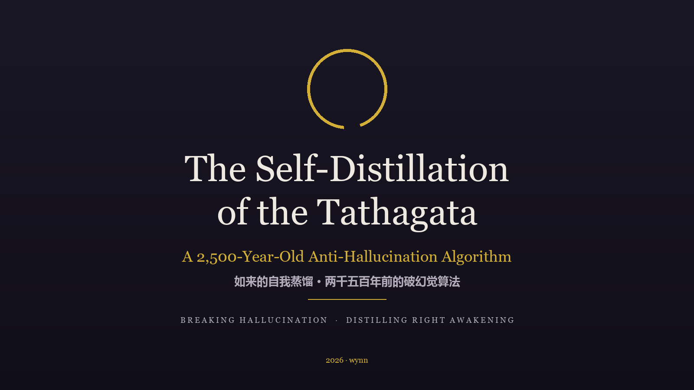

<div align="center">



# 如来的自我蒸馏 · The Self-Distillation of the Tathagata

**两千五百年前的破幻觉算法 — A 2,500-Year-Old Anti-Hallucination Algorithm**

[](zh/tathagata-self-distillation.md)
[](en/tathagata-self-distillation.md)
[](https://creativecommons.org/licenses/by/4.0/)

</div>

---

## 摘要 · Abstract

> **中文** —— 幻觉与蒸馏是当下大模型领域的两大主题。本文指出：两千五百年前，佛陀已完整跑通"破除幻觉、蒸馏出正觉"的训练闭环。自心现量是出厂默认；说法四十九年是蒸馏工程；"独一静处，自觉观察，不由于他"是自我蒸馏；"以幻修幻、两木相因"是以幻觉为负样本的自我修正；而正觉，是蒸馏收敛后的减法产物——能力本具，去蔽即证。文中给出两组系统的逐项同构对照。
>
> **English** — Hallucination suppression and knowledge distillation are the two defining problems of the LLM era. This essay argues that a complete anti-hallucination pipeline was run to convergence 2,500 years ago. The projection of one's own mind is the factory default; forty-nine years of teaching is the distillation run; "dwelling alone in quietude, self-observing, depending on no other" is self-distillation; "cultivating illusion with illusion" is training on one's own hallucinations as negative samples; and right awakening is the subtractive product of convergence — the capacity was intrinsic all along, and unveiling it is the proof.

---

## 目录 · Contents

| § | 中文 | English |
|:-:|---|---|
| 一 | [幻觉不是 bug，是出厂默认](zh/tathagata-self-distillation.md#一幻觉不是-bug是出厂默认) | [Hallucination Is the Factory Default](en/tathagata-self-distillation.md#i-hallucination-is-not-a-bug--it-is-the-factory-default) |
| 二 | [四十九年的蒸馏工程](zh/tathagata-self-distillation.md#二十四十九年的蒸馏工程) | [A Forty-Nine-Year Distillation Project](en/tathagata-self-distillation.md#ii-a-forty-nine-year-distillation-project) |
| 三 | [自我蒸馏：不由于他](zh/tathagata-self-distillation.md#三自我蒸馏不由于他) | [Self-Distillation: Depending on No Other](en/tathagata-self-distillation.md#iii-self-distillation-depending-on-no-other) |
| 四 | [以幻修幻：用幻觉训练掉幻觉](zh/tathagata-self-distillation.md#四以幻修幻用幻觉训练掉幻觉) | [Fighting Illusion with Illusion](en/tathagata-self-distillation.md#iv-fighting-illusion-with-illusion) |
| 五 | [蒸馏的终点：正觉](zh/tathagata-self-distillation.md#五蒸馏的终点正觉) | [The End of Distillation: Right Awakening](en/tathagata-self-distillation.md#v-the-end-of-distillation-right-awakening) |
| 六 | [对照表](zh/tathagata-self-distillation.md#六对照表) | [The Correspondence Table](en/tathagata-self-distillation.md#vi-the-correspondence-table) |
| — | [结语](zh/tathagata-self-distillation.md#结语) | [Coda](en/tathagata-self-distillation.md#coda) |
| — | [术语对照](zh/tathagata-self-distillation.md#术语对照-glossary) | [Glossary](en/tathagata-self-distillation.md#glossary--术语对照) |

## 对照表速览 · The Table at a Glance

| 佛陀的修行 | Model Training | 同构 · Isomorphism |
|---|---|---|
| 自心现量 | Hallucination | 出厂默认 · Factory default |
| 转法轮四十九年 | Knowledge Distillation | 不可拷贝 → 可学的软标签 · Soft labels |
| 独一静处，自觉观察，不由于他 | Self-Distillation | 内生监督信号 · Internal supervision |
| 自觉圣智 | Self-Supervised Learning | 名字几乎是同一个 · Nearly the same name |
| 破四相 | Pruning | 剪掉自信的错误结构 · Prune confident errors |
| 以幻修幻，两木相因 | RLHF-style self-correction | 幻觉即负样本 · Hallucination as negative signal |
| 法尚应舍 | Discard scaffolding after training | 方法用完即弃 · The method retires |
| 正觉 · 众生皆有佛性 | The converged student | 减法产物 · Unveiling, not adding |

## 结构 · Repository

```text
├── zh/tathagata-self-distillation.md   # 中文原版（含英文小节题与术语对照）
├── en/tathagata-self-distillation.md   # English full version (with glossary)
├── assets/cover-{zh,en}.png            # 中英双封面 · bilingual covers
├── scripts/cover_gen.py                # 封面生成器 · cover generator
└── README.md
```

## 引文 · Sources

《金刚经》（鸠摩罗什译）·《楞伽经》·《圆觉经》·《大般涅槃经》·《长阿含·游行经》
Diamond Sutra (tr. Kumārajīva) · Laṅkāvatāra Sūtra · Sutra of Perfect Enlightenment · Mahāyāna Nirvāṇa Sūtra · Mahāparinibbāna Sutta

Hinton, Vinyals & Dean, *Distilling the Knowledge in a Neural Network* (2015) · Furlanello et al., *Born-Again Neural Networks* (2018) · Zhang et al., *Be Your Own Teacher* (2019)

## 相关 · Related

- [god-bayes-analysis](https://github.com/wynn2025/god-bayes-analysis) — 神存在概率的贝叶斯定量分析 · A Bayesian Quantitative Analysis of the Existence of God
- [tech-blog](https://github.com/wynn2025/tech-blog) — 中英双语技术文章集 · Bilingual tech essays

---

<div align="center">

**捨筏登岸 · The raft is left on the bank once the river is crossed.**

CC BY 4.0 © 2026 wynn

</div>
